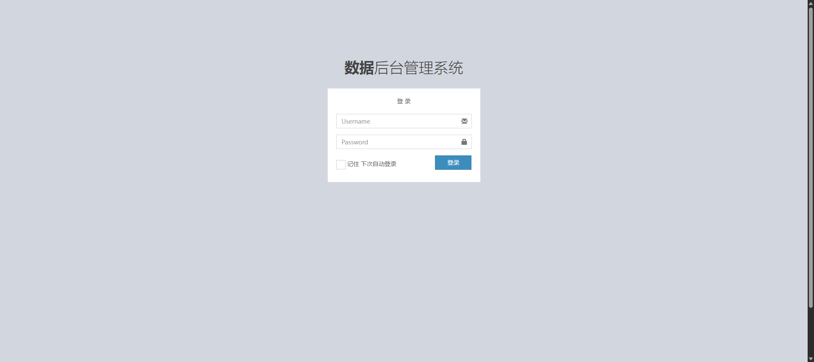
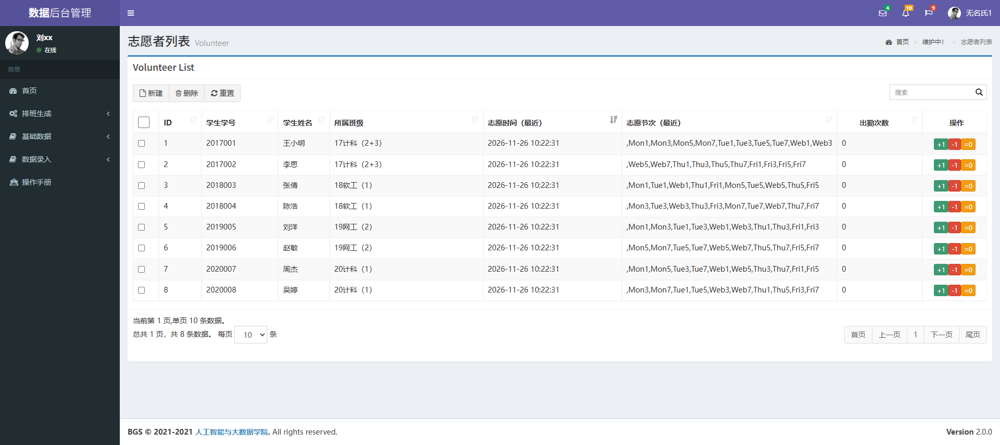
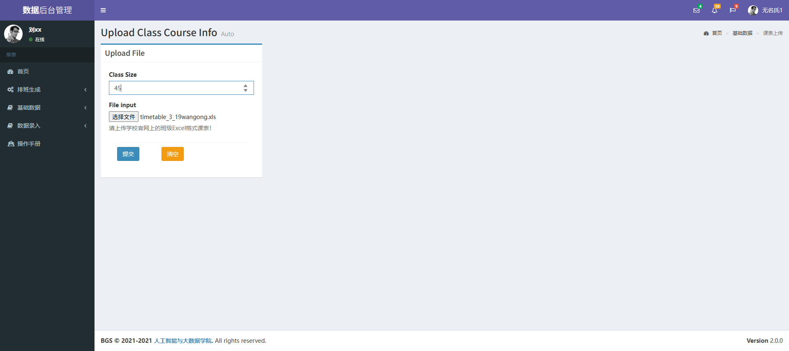
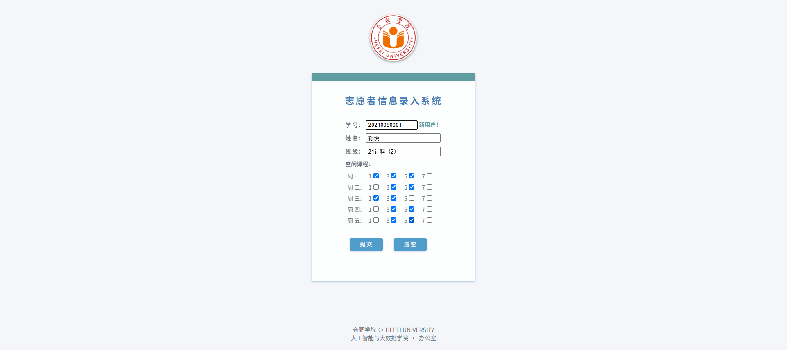
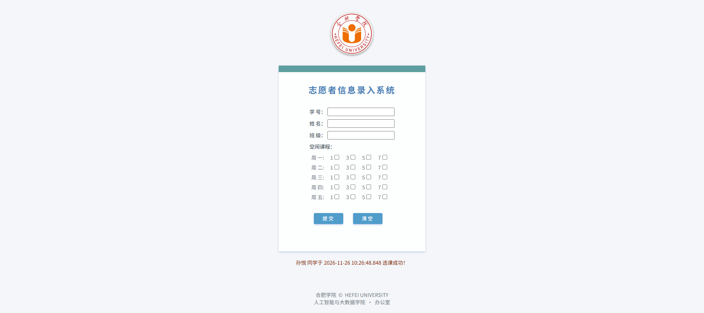
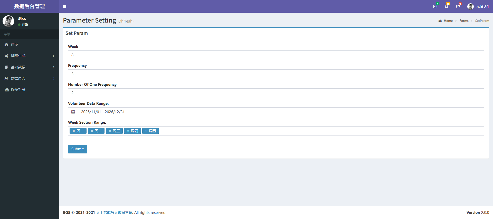
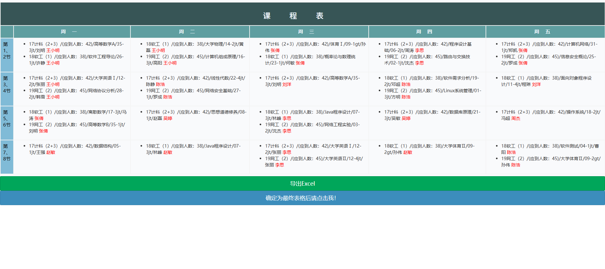
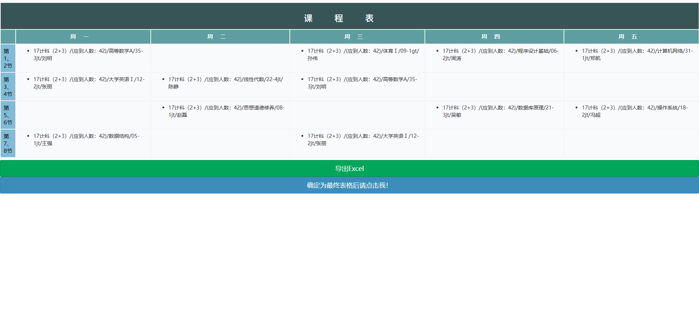

# sortclass · 大学课表 / 查课排班系统

一个基于 **SSM（Spring + SpringMVC + MyBatis）+ JSP** 的教学巡查排班系统：
管理员把各班级的课表（Excel）导进来，学生自助登记自己的空闲节次，系统按课表自动算出
**"每个节次、每门课由哪名志愿者去查课"** 的最终排班表。

原仓库：<https://github.com/1053278842/sortclass>。
本仓库在原始代码基础上补齐了数据库脚本、样例课表、演示数据和启动文档，并修复了几处导致页面跑不起来的 bug
（清单见 [第 9 节](#9-相对原仓库的改动)）。

---

## 1. 效果预览

> 图片走 jsDelivr CDN（GitHub 的 `raw.githubusercontent.com` / 图片代理在国内经常打不开，
> 图片文件本身就在仓库的 [`docs/screenshots`](docs/screenshots) 目录里，可直接下载查看）。

| 最终排班表（核心页面） | 志愿者空闲时间登记（学生端） |
| --- | --- |
|  |  |

更多截图（点击可看大图）：

| 截图 | 说明 |
| --- | --- |
| [01-login.png](https://gcore.jsdelivr.net/gh/1053278842/sortclass@master/docs/screenshots/01-login.png) | 后台登录页 |
| [02-volunteer-list.png](https://gcore.jsdelivr.net/gh/1053278842/sortclass@master/docs/screenshots/02-volunteer-list.png) | 首页：志愿者列表（分页 / 搜索 / 出勤次数 ±1） |
| [03-upload-timetable.png](https://gcore.jsdelivr.net/gh/1053278842/sortclass@master/docs/screenshots/03-upload-timetable.png) | 班级课表上传（填班级人数 + 选 `.xls`） |
| [04-volunteer-register.png](https://gcore.jsdelivr.net/gh/1053278842/sortclass@master/docs/screenshots/04-volunteer-register.png) | 学生端匿名页：填学号姓名班级、勾选空闲节次 |
| [05-volunteer-success.png](https://gcore.jsdelivr.net/gh/1053278842/sortclass@master/docs/screenshots/05-volunteer-success.png) | 登记成功回显（"xxx 同学于 … 选课成功！"） |
| [06-generate-params.png](https://gcore.jsdelivr.net/gh/1053278842/sortclass@master/docs/screenshots/06-generate-params.png) | 排班参数设置（周次 / 频率 / 日期区间 / 周段） |
| [07-final-table.png](https://gcore.jsdelivr.net/gh/1053278842/sortclass@master/docs/screenshots/07-final-table.png) | **最终排班表**：5 天 × 4 大节，红字为分配的志愿者 |
| [08-class-timetable.png](https://gcore.jsdelivr.net/gh/1053278842/sortclass@master/docs/screenshots/08-class-timetable.png) | 单班级课表查看（不带志愿者） |

---

## 2. 技术栈

| 层 | 技术 |
| --- | --- |
| 表现层 | JSP + JSTL + AdminLTE 2 / Bootstrap 3 / jQuery 2（模板来自 AdminLTE 后台主题） |
| 控制层 | Spring MVC 5.3.7（`DispatcherServlet` 映射 `*.do`） |
| 业务层 | Spring 5.3.7（IoC + 声明式事务）、PageHelper 5.1.2 分页 |
| 持久层 | MyBatis 3.4.5（**纯注解 Mapper**，无 XML）、c3p0 连接池 |
| 数据库 | MySQL 5.7（演示用 Docker 起） |
| 其它 | jxl 2.6.12 读 Excel、POI 3.9 导出 Excel、Spring Security 5（表单登录）、Maven 多模块 |

> 这个项目是"老派 Java Web"：`javax.servlet` + 外置 Tomcat + JSP。
> **必须用 Tomcat 9**（Tomcat 10 换成了 `jakarta.servlet`，跑不起来）。

---

## 3. 目录结构

```
sortclass/
├── pom.xml                     # 父 POM（聚合 + 依赖版本管理）
├── ssm_domain/                 # 实体：Student、Course、Grade、SingleClass、ClassSection、WeekTables
├── ssm_dao/                    # MyBatis 注解 Mapper：IStudentDao、ICourseDao、IGradeDao、ISingleClassDao
├── ssm_service/                # 业务接口与实现（事务在这一层）
├── ssm_utils/                  # 工具：CourseSectionUtils（坐标→节次）、DateUtils
├── ssm_web/                    # Web 层
│   ├── src/main/java/com/ssm/controller/
│   │   ├── UploadController.java        # 课表 Excel 解析入库
│   │   ├── StudentController.java       # 志愿者登记（匿名可访问）
│   │   ├── AdminStudentController.java  # 志愿者列表 JSON、出勤次数维护
│   │   ├── AdminTableController.java    # ★ 排班算法、导出 Excel
│   │   ├── CourseController.java        # 单班级课表查看
│   │   └── GradeController.java         # 班级下拉数据
│   ├── src/main/resources/              # applicationContext.xml / spring-mvc.xml / spring-security.xml / db.properties
│   └── src/main/webapp/                 # JSP 页面、AdminLTE 静态资源
├── db/
│   ├── schema.sql              # 建库建表（4 张表）
│   ├── seed.sql               # 演示数据（3 班级 / 32 课程 / 9 志愿者）
│   └── docker-compose.yml     # 本地起 MySQL 5.7 并自动导入上面两个脚本
├── docker/                     # 镜像构建（阿里云 ACR 里已发布 sortclass-web / sortclass-mysql）
│   ├── Dockerfile.web         # Tomcat 9 + JDK 17 + war
│   ├── Dockerfile.mysql       # MySQL 5.7 + schema + seed
│   ├── entrypoint.sh          # 等 DB → 解压 war → 按环境变量写 db.properties
│   └── docker-compose.yml     # 用镜像一键起整套
├── samples/                    # 三个班级课表 .xls（可直接上传），格式说明见 samples/README.md
└── docs/screenshots/           # 复现出来的页面截图
```

---

## 4. 快速开始

### 4.1 环境要求

| 组件 | 版本 | 说明 |
| --- | --- | --- |
| JDK | 8 或 11/17 | 本次复现用的是 **JDK 17.0.11**，编译目标 `1.8` |
| Maven | 3.6+ | 本次用 3.8.5 |
| MySQL | 5.7（推荐）或 8.0 | 用 Docker 起最省事；8.0 需要用新驱动，见 [第 10 节](#10-常见问题) |
| Tomcat | **9.0.x** | 本次用 9.0.124；切勿用 Tomcat 10+ |
| Docker | 可选 | 只为起 MySQL，本机已有 MySQL 可跳过 |

> **只想看效果、不想装 JDK/Tomcat/MySQL？** 直接用打包好的镜像，两条命令起来：
> 见 [第 11 节 Docker 镜像](#11-docker-镜像阿里云-acr)。

### 4.2 起数据库

```bash
cd db
docker compose up -d          # 端口 13306，账号 root / sortclass
```

容器首次启动会自动执行 `schema.sql` + `seed.sql`，所以起来就有演示数据。

不用 Docker 的话，自己建库再导入即可：

```sql
CREATE DATABASE sortclass DEFAULT CHARACTER SET utf8mb4;
```

```bash
mysql -uroot -p < db/schema.sql
mysql -uroot -p < db/seed.sql
```

数据库连接配置在 [`ssm_web/src/main/resources/db.properties`](ssm_web/src/main/resources/db.properties)：

```properties
jdbc.driver=com.mysql.jdbc.Driver
jdbc.url=jdbc:mysql://127.0.0.1:13306/sortclass?useUnicode=true&characterEncoding=utf8
jdbc.username=root
jdbc.password=sortclass
```

> 换成自己的 MySQL 时，只需要改这个文件（端口、账号、密码）。
> 注意库名必须是 `sortclass`：所有 SQL 都写死了 `sortclass.表名` 前缀。

### 4.3 打包

```bash
mvn clean package -DskipTests
```

产物：`ssm_web/target/ssm_web.war`（约 35 MB，大部分是 AdminLTE/ckeditor 等前端资源）。

若公司内网 `settings.xml` 配了不可用的私服，可以临时指定公共镜像：

```bash
mvn -s settings.xml -gs settings.xml clean package -DskipTests
```

### 4.4 部署到 Tomcat 9

```bash
cp ssm_web/target/ssm_web.war $CATALINA_HOME/webapps/
$CATALINA_HOME/bin/startup.sh        # Windows: startup.bat
```

默认端口 8080 被占用时改 `$CATALINA_HOME/conf/server.xml` 里的 `<Connector port="8080" ...>`。
本次复现用的是 18090 端口。

### 4.5 访问

| 入口 | 地址 | 是否需要登录 |
| --- | --- | --- |
| 后台登录 | `http://localhost:8080/ssm_web/pages/login.jsp` | — |
| 志愿者登记（发给学生） | `http://localhost:8080/ssm_web/pages/InputPages/inputVolunteerInfo.jsp` | 否（匿名可填） |
| 后台首页 | `http://localhost:8080/ssm_web/pages/main.jsp` | 是 |

账号（写在 `spring-security.xml` 里的内存用户）：

| 账号 | 密码 | 角色 | 能否进后台 |
| --- | --- | --- | --- |
| `admin` | `admin` | `ROLE_ADMIN` | ✅ |
| `user` | `user` | `ROLE_USER` | ❌（后台要求 ROLE_ADMIN） |

---

## 5. 使用流程（5 步复现整张排班表）

> 下面每一步都对应一张截图，按顺序做即可得到 `docs/screenshots/07-final-table.png` 的效果。
> 其实 `db/seed.sql` 已经把"跑完 1~3 步"的数据准备好了，想直接看结果可以跳到第 4 步。

### 第 1 步：登录后台

打开 `/pages/login.jsp`，用 `admin / admin` 登录，进入「志愿者列表」首页。




### 第 2 步：上传班级课表

左侧菜单「数据录入 → 班级课表录入」，填入班级人数，选择 `samples/timetable_1_17jike.xls`，提交。



系统会解析 Excel：A1 的"17计科（2+3）课表"变成班级名，每个有课的格子变成一条课程记录，
格子位置决定它是周几第几大节。**重复上传同一个班级不会产生重复数据**：同名班级会更新人数、
删掉该班旧课程后重建。对 `samples/` 里三个文件各上传一次，就得到 3 个班级 / 32 条课程。

### 第 3 步：学生登记空闲时间

把志愿者登记页地址发给学生（无需登录）：



学号、姓名、班级 + 勾选空闲的大节，提交后回显：



同一个学号重复提交是**覆盖更新**（不会重复插入）。学号输入框旁边的"新用户！/老朋友！"提示
走的是 `/Student/isExistBySno.do` 这个 AJAX 接口。

### 第 4 步：设置排班参数

左侧菜单「排班生成 → 参数设置」：

| 参数 | 含义 | 本次演示取值 |
| --- | --- | --- |
| Week | 第几周（用来筛掉不在该周上的课） | `8` |
| Frequency | 一名志愿者一周最多跑几个节次 | `3` |
| Number Of One Frequency | 一个节次里一名志愿者最多负责几门课 | `2` |
| Volunteer Data Range | 只统计该时间段内报名的志愿者 | `2026/11/01 - 2026/12/31` |
| Week Section Range | 参与排班的周段（可多选） | 周一 ~ 周五 |



### 第 5 步：查看最终排班表

点 Submit 会**新开一个窗口**，得到最终表格：行是大节，列是星期，每格列出该节次的所有课程
（`班级 / 应到人数 / 课程 / 教室 / 教师`），**红色的是分配到的志愿者**；
还没分配出去的课程（志愿人数不够时）会以队列形式继续显示在格子里。



点「确定为最终表格后请点击我」会把这批志愿者的出勤次数 `times` 各 +1（走 `AdminTable/addTimes.do`）。

### 附：只看某班课表

「基础数据 → 课程管理」，班级下拉是动态从数据库读的，周次留空表示整学期：



---

## 6. 数据库表结构

4 张表，关系很简单：

```
classes_grades (班级)  1 ──< grades_course_relationship (班级-课程) >──  n  course (课程)
student (志愿者)            独立表，空闲节次用逗号串存一列
```

| 表 | 关键字段 | 说明 |
| --- | --- | --- |
| `classes_grades` | `id`、`class_name`（唯一）、`size` | 一行一个班级，人数由上传时手填 |
| `course` | `id`、`course_name`、`course_time`、`course_location`、`course_teacher_name`、`course_section` | `course_time` 是周次范围（`1-13`）；`course_section` 是大节（`Mon1`…`Fri7`，**周三写作 `Web`**，沿用原代码的拼写） |
| `grades_course_relationship` | `id`、`grades_id`、`course_id` | 多对多中间表；同班同课去重 |
| `student` | `id`、`sno`（唯一）、`name`、`classes`、`date`、`freeClasses`、`times` | `freeClasses` 形如 `,Mon1,Mon3,Fri7`；`times` 是已排班次数，用于均衡 |

建表语句见 [`db/schema.sql`](db/schema.sql)，演示数据见 [`db/seed.sql`](db/seed.sql)。

---

## 7. 原理

### 7.1 课表上传：用正则把"一格一课"的 Excel 拆成结构化数据

`UploadController.fileUpload()` 干三件事：

1. **班级**：读 A1 标题（如 `17计科（2+3）课表`），去掉 `课表` 两字得到班级名，配合表单里填的人数
   写入 `classes_grades`。已存在同名班级则改人数、删旧课程、删旧关系，等于"覆盖导入"。
2. **节次**：靠**单元格坐标**反推。列 3~7 → `Mon/Tue/Web/Thu/Fri`，行 3~6 → `1/3/5/7`，
   拼起来就是 `Mon1`、`Web5` 这种大节名（对应 `CourseSectionUtils.getCourseSectionByXY`）。
3. **课程**：靠**正则**拆单元格文本。规则放在 `regular_expression.properties`：

   ```
   (课程名)/(起始周-结束周)周/(性质) (教室)/(教师)/(人数)/(学分)
   ```

   一个格子里有多门课就多匹配几次（`matcher.find()` 循环）。课程按"名称+周次+教室+教师+节次"
   去重：已存在就复用，不存在才插入，最后写中间表。

### 7.2 空闲时间登记

前端 20 个 `checkbox`（5 天 × 4 大节，`name="freeClass"`，`value="Mon1"`…），
提交时 Spring 把它绑成 `String[] freeClass`，后端拼成 `,Mon1,Mon3,...` 存一列字符串。
按学号 upsert：存在则覆盖（`updateStudentBySno`），不存在才 `insert`。

### 7.3 排班算法：按"课程/志愿人数"的权重贪心分配

核心在 `AdminTableController.generateTable()`，配合 `WeekTables`、`ClassSection` 两个领域对象：

1. **建骨架**：`WeekTables` 构造时固定生成 20 个 `ClassSection`（Mon1 ~ Fri7）。
2. **装课程**：按 `week` 过滤（`left(course_time,2) <= week <= right(course_time,2)`），
   再按表单选的 `weekSectionRange` 丢掉不参与的周段，剩下的进各自节次的 `singleClassesQueue`。
3. **装志愿者**：把报名时间落在 `dateRange` 内的学生，按 `freeClasses` 拆开，
   匹配到的节次就进该节次的 `selectedStudentQueue`。
4. **动态出勤数**：每个节次按课程数算"一个志愿者最多管几门课"——
   `d = ceil(课程数 / 单频次上限)`，`每人间隔 = ceil(课程数 / d)`，
   这样既不会出现"10 门课让一个人跑 9 门、第二个只跑 1 门"的极端分配。
5. **贪心主循环**：
   - 权重 `weight = 该节次待排课程数 / 该节次可用志愿者数`（没有志愿者则记 0），
     权重越高说明"课多人心"，越该先排；
   - 每次取权重最高的节次，从两个队列各取队首（课程按班级名、志愿者按到达顺序），
     配成一个 `SingleClass`（= 一次查课任务），课程出队、塞进用于渲染的 `singleClasses`；
   - 同一节次里一个志愿者排满"每人间隔"门课就出队，其 `hasSelectedTimes + 1`；
     当 `hasSelectedTimes >= frequency` 时该志愿者**全局停用**（不再参与其他节次）；
   - 每轮结束重算权重并降序排序，直到所有节次权重都为 0（课排完或没人可用）为止。

   注释里叫它"重要性排序"，本质是**带容量约束的贪心 + 权重重排**：先把最缺人的节次喂饱，
   排空一个再重算，保证每一轮都优先解决最紧张的节次。
6. **落地**：结果对象丢进 `request` + `session`。JSP 用 JSTL 遍历 20 个节次渲染成 4×5 的表格，
   已分配的课程从 `singleClasses` 出来（红字带志愿者名），没排上的从 `singleClassesQueue` 出来。
   放在 session 里是为了"确定为最终表格"时能拿到同一份数据去给志愿者加出勤次数。

### 7.4 前端

JSP + JSTL 服务端渲染，AdminLTE 2 的后台框架（左侧菜单在 `aside.jsp`，顶栏在 `header.jsp`，
首页内容在 `student_list.jsp`）。志愿者登记页和学生课表用的是单独的一套 CSS，不套后台框架。
表格页 `weekTable_hasStudents.jsp` 里 20 个格子是 20 段几乎一样的 `<c:if>`，属于典型的"复制粘贴式渲染"，
想加"周六"就得再复制 4 段——这也是原项目的风格，本次没有重构它。

> 导出 Excel 的按钮目前是"维护中"：`AdminTableController.excelPrint()` 用 POI 生成了 `.xls`，
> 但前端按钮被改成了 `alert('此功能维护中！')`，属于原仓库遗留状态，未改动。

---

## 8. 接口一览

| 方法 | 路径 | 作用 | 权限 |
| --- | --- | --- | --- |
| POST | `/pages/login` | Spring Security 表单登录 | 匿名 |
| POST | `/upload/fileUpload.do` | 上传并解析课表 | ADMIN |
| POST | `/Student/addStudent.do` | 志愿者登记（覆盖更新） | 匿名 |
| GET | `/Student/isExistBySno.do` | 学号是否已存在 | 匿名 |
| GET | `/AdminStudent/findAllByMoreCondition.do` | 志愿者分页 / 搜索 / 排序（JSON） | ADMIN |
| GET | `/AdminStudent/deleteById.do`、`updateAddTimesById.do`、`updateMinusTimesById.do`、`updateClearTimesById.do` | 志愿者维护 | ADMIN |
| GET | `/Grade/getAllGrade.do` | 班级列表（JSON，下拉框用） | ADMIN |
| POST | `/AdminTable/generateTable.do` | **生成最终排班表** | ADMIN |
| POST | `/AdminTable/addTimes.do` | 确认最终表 → 志愿者出勤次数 +1 | ADMIN |
| GET | `/AdminTable/excelPrint.do` | 导出排班表 Excel（前端入口暂时关闭） | ADMIN |
| POST | `/Course/showCourseTable.do` | 单班级课表（week 为空表示整学期） | ADMIN |

---

## 9. 相对原仓库的改动

原仓库 clone 下来是编译不过、也跑不通的（缺库、缺数据、几个页面必炸）。为了能真实复现效果，做了下面这些改动，
**业务逻辑本身没有重写**：

### 9.1 让它能编译

| 文件 | 问题 | 处理 |
| --- | --- | --- |
| `pom.xml` | `packaging=war` 的聚合工程，模块列表里还有个根本不存在的 `com.ssm.utils` | 改成 `pom` 打包、删掉不存在的模块、统一 `source/target=8` |
| `pom.xml` | `maven-war-plugin` 里塞了 `<source>/<target>` 这种插件不认识的参数 | 换成正确的 compiler 插件配置 |
| `AdminTableController.java` | `import jdk.internal.util.xml.impl.Input;`（JDK9+ 无法访问） | 删掉这个没用到的 import |
| `ssm_web/pom.xml` | 编译级别 1.7，JDK 17 已不支持 | 改 1.8 |

### 9.2 让它跑得通

| 位置 | 问题 | 处理 |
| --- | --- | --- |
| `AdminTableController.generateTable()` | 日期区间用 `split("-")`，而页面日期控件输出的是 `2026/11/01 - 2026/12/31`，**必然数组越界 500** | 改成用正则抓出两个日期（兼容 `/`、`-`、`年月日`、`至`），结束日期补 `23:59:59` |
| 同上 | 某节次"有课但没志愿者"时会 `student.isCanSelected()` 空指针，甚至死循环 | 加空判断 + 跳出该节次 |
| `AdminStudentController.findAllByMoreCondition()` | 参数上同时写了 `@RequestBody` 和 `@RequestParam`，GET 请求没有请求体 → **400** | 去掉 `@RequestBody`（表单/GET 传参） |
| `StudentController.isExistBySno()` | 同上，学号提示接口必失败 | 同上 |
| `spring-security.xml` | 志愿者登记页是匿名的，但它的提交接口 `/Student/**` 被拦成 302 跳登录页 → 学生永远提交不成功 | 放行 `/Student/**` |
| `inputVolunteerInfo.jsp` | 匿名页里有个调 `/AdminStudent/*` 的 AJAX，必然报错弹窗 | 删掉这段只 `$("#data_list").html("")` 的死代码 |
| `setTableViewParam.jsp` | 班级下拉写死了 Alabama/Texas 等州名，无法选到真实班级 | 改成 AJAX 调 `/Grade/getAllGrade.do` 动态填充 |
| `db.properties` | 指向作者自己的公网数据库（117.50.175.251） | 改为本地 `127.0.0.1:13306`，账号见 docker-compose |

### 9.3 新增的文件

```
db/schema.sql               # 4 张表的建表语句
db/seed.sql                 # 演示数据（真实走完流程后 mysqldump 出来的）
db/docker-compose.yml       # MySQL 5.7 + 自动初始化
samples/*.xls               # 3 个班级课表样例
samples/README.md           # 课表格式说明
docs/screenshots/*.png      # 复现出来的 8 张页面截图
README.md                   # 本文件
```

---

## 10. 常见问题

**Q：`mvn` 卡在下载依赖 / 报 `app.finedo.cn` 连接超时？**
全局 `settings.xml` 里把 central 镜像指到了内网私服。加 `-s` 且 `-gs` 指向一个镜像可用的 settings 文件：

```xml
<mirror>
  <id>aliyun</id>
  <url>https://maven.aliyun.com/repository/public</url>
  <mirrorOf>*</mirrorOf>
</mirror>
```

**Q：部署后 404 / 500，日志里是 `NoClassDefFoundError: javax/servlet/...`？**
用了 Tomcat 10+。换 Tomcat 9.0.x。

**Q：JSP 报 `Unable to compile class for JSP`？**
JDK 版本比 Tomcat 自带的 JDT 新太多时会这样，用 Tomcat 9.0.6x 以上 + JDK 8/11/17 都实测可用。

**Q：页面上班级、课程都是空？**
先确认 `db.properties` 连的库里有数据（`select count(*) from sortclass.course;`）。
空库就按第 4.2 节导入 `seed.sql`，或者按第 5 节走一遍上传流程。

**Q：上传 Excel 后课程数不对 / 少了最后几节？**
解析扫描的是 `行数-3` 行，表格行数太少会漏掉"第7、8节"。样例文件末尾留了几行空行就是这个原因。
另外 A1 必须是"班级名+课表"，格子里必须是 `课程名/1-13周/理论 35-3jt/刘明/42/4.0` 这种格式。

**Q：想换 MySQL 8.0？**
`mysql-connector-java` 是 5.1.6，不支持 MySQL 8 默认的 `caching_sha2_password`。
把依赖升到 `8.0.33`、驱动类改成 `com.mysql.cj.jdbc.Driver`、URL 加上 `serverTimezone=Asia/Shanghai&useSSL=false`
即可；演示环境建议直接用 5.7，最省事。

**Q：排班表里为什么有的课程没人（红字为空）？**
算法是贪心：志愿者总量（人数 × `Frequency`）不够覆盖所有课程时，排在后面的课程就分不到人。
把 `Frequency` 调大、或让更多学生来登记空闲时间即可。

**Q：重启了数据库之后，第一次访问报 `Communications link failure`？**
c3p0 连接池里握着的是旧连接。再刷一次即可（池子会自动重建），或者重启 Tomcat 让连接池重新初始化。

**Q：数据集想恢复成初始状态？**

```bash
docker compose down -v && docker compose up -d    # 删卷重建，自动重放 schema + seed
```

---

## 11. Docker 镜像（阿里云 ACR）

已经在阿里云个人版镜像仓库里放好了两个镜像（命名空间 `liunidie`，上海地域）：

| 镜像 | 内容 | 大小 |
| --- | --- | --- |
| `liunidie/sortclass-web:1.0.0` | Tomcat 9 + JDK 17 + `ssm_web.war`，启动时按环境变量生成数据源配置 | ≈533 MB |
| `liunidie/sortclass-mysql:1.0.0` | MySQL 5.7 + `schema.sql` + `seed.sql`，首次启动自动建表灌数据 | ≈501 MB |

完整地址：

```
crpi-jjrtzj5uuz1ioat1.cn-shanghai.personal.cr.aliyuncs.com/liunidie/sortclass-web:1.0.0
crpi-jjrtzj5uuz1ioat1.cn-shanghai.personal.cr.aliyuncs.com/liunidie/sortclass-mysql:1.0.0
```

### 11.1 最快启动：docker compose

```bash
git clone https://github.com/1053278842/sortclass.git
cd sortclass
docker compose -f docker/docker-compose.yml up -d
```

浏览器打开 <http://localhost:8080/ssm_web/pages/login.jsp>，`admin / admin` 登录。
首次启动会等 MySQL 初始化完（约 20~40 秒）再拉起 Tomcat，日志里能看到
`[entrypoint] MySQL ... 已就绪`。

常用命令：

```bash
docker compose -f docker/docker-compose.yml ps
docker compose -f docker/docker-compose.yml logs -f web
docker compose -f docker/docker-compose.yml down     # 停止，数据保留在卷里
docker compose -f docker/docker-compose.yml down -v  # 连数据一起删，下次重新导入演示数据
```

### 11.2 或者手动 docker run

```bash
REG=crpi-jjrtzj5uuz1ioat1.cn-shanghai.personal.cr.aliyuncs.com/liunidie

docker network create sortclass

docker run -d --name sortclass-mysql --network sortclass \
  -e MYSQL_ROOT_PASSWORD=sortclass \
  -v sortclass-mysql-data:/var/lib/mysql \
  $REG/sortclass-mysql:1.0.0

docker run -d --name sortclass-web --network sortclass \
  -e DB_HOST=sortclass-mysql -e DB_PASSWORD=sortclass \
  -p 8080:8080 \
  $REG/sortclass-web:1.0.0
```

### 11.3 可配置的环境变量（web 镜像）

| 变量 | 默认值 | 说明 |
| --- | --- | --- |
| `DB_HOST` | `mysql` | MySQL 主机名 |
| `DB_PORT` | `3306` | 端口 |
| `DB_NAME` | `sortclass` | 库名（**必须**叫 `sortclass`，SQL 里写死了库名前缀） |
| `DB_USER` | `root` | 账号 |
| `DB_PASSWORD` | `sortclass` | 密码 |
| `DB_PARAMS` | `useUnicode=true&characterEncoding=utf8&useSSL=false` | JDBC 连接参数 |
| `DB_WAIT_SECONDS` | `90` | 启动时等待数据库的最长秒数 |
| `JAVA_OPTS` | `-Duser.timezone=Asia/Shanghai -Dfile.encoding=UTF-8 -Xms256m -Xmx512m` | JVM 参数 |

容器启动脚本 [`docker/entrypoint.sh`](docker/entrypoint.sh) 做的三件事：
等 MySQL 端口通 → 解压 war → 用上面的变量覆盖 `WEB-INF/classes/db.properties`，然后 `exec catalina.sh run`。
所以同一份 war 镜像可以直连任何 MySQL，不用改代码重新打包。

### 11.4 自己重新构建 / 推送

```bash
mvn clean package -DskipTests          # 先出 war

REG=crpi-jjrtzj5uuz1ioat1.cn-shanghai.personal.cr.aliyuncs.com/liunidie
docker build -f docker/Dockerfile.web   -t $REG/sortclass-web:1.0.0   .
docker build -f docker/Dockerfile.mysql -t $REG/sortclass-mysql:1.0.0 .

docker push $REG/sortclass-web:1.0.0
docker push $REG/sortclass-mysql:1.0.0
```

推之前先登录（个人版 ACR 用仓库的固定域名 + 账号密码）：

```bash
docker login crpi-jjrtzj5uuz1ioat1.cn-shanghai.personal.cr.aliyuncs.com
```

### 11.5 镜像使用注意

- **数据持久化**：`sortclass-mysql` 的数据在 `/var/lib/mysql` 卷里；删卷 = 重新导入演示数据。
- **端口**：容器内固定 8080，映射到宿主机哪个端口随意（`-p 18080:8080` 也行）。
- **没有内置 Nginx/HTTPS**：仅适合演示/内网，正式环境建议前面加反向代理。
- 镜像里带了演示数据，**别把 root 密码就这么放公网**；改 `MYSQL_ROOT_PASSWORD` + `DB_PASSWORD` 即可。

---

## 12. 说明

- 演示数据里的姓名、学号、课程都是编的，仅用于展示，版权归原始作者所有。
- 截图由真实运行的系统产生（Tomcat 9.0.124 + JDK 17 + MySQL 5.7），不是设计稿。
- 原仓库地址：<https://github.com/1053278842/sortclass>