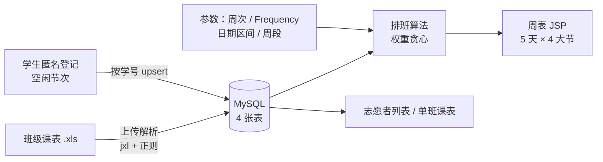

# sortclass · 高校查课排班系统

**上传班级课表 → 学生登记空闲节次 → 自动排出「每节课谁去查课」的周表。**

SSM（Spring + SpringMVC + MyBatis）+ JSP 的 Java Web 项目：一套 Excel 课表解析 + 一个权重贪心排班算法，
把原来手工排的「教学巡查值班表」变成一条命令。

   


↑ 5 天 × 4 大节，每格列出该节次的课程（班级 / 应到人数 / 课程 / 教室 / 教师），**红字是分到的志愿者**。

## 这是什么

高校教务每周都要安排“查课志愿者”：每门课得有个人去点名。课在周几第几大节、学生什么时候有空、
一人一周最多跑几趟——手工排经常撞车。这个系统把三件事串起来：

1. 管理员把教务系统导出的**班级课表 Excel** 传上去，自动拆成「班级 / 课程 / 节次」；
2. 学生打开一个**匿名网页**勾自己的空闲大节，不用注册；
3. 点一下「生成」，按权重贪心算法排出整张周表，确认后志愿者的出勤次数自动 +1。

## 能干什么

- **不用手工排表** —— 配 4 个参数，20 个节次的查课人一次算完，直接渲染成周表
- **课表直接吃** —— 教务那种「一格一课」的 `.xls`，拖进去就解析出班级、课程、教室、教师、周次
- **学生零门槛登记** —— 匿名页勾 20 个格子即可，重复提交自动覆盖，不用建账号
- **排得均匀** —— 按「待排课程数 ÷ 可用人数」算权重，先喂最缺人的节次；同一人一周最多跑 `Frequency` 趟
- **开箱可复现** —— 一条 `docker compose` 带演示数据（3 班级 / 32 门课 / 9 名志愿者）起来

## Quick Start

```bash
git clone https://github.com/1053278842/sortclass.git
cd sortclass
docker compose -f docker/docker-compose.yml up -d
# 等约 30 秒（首次要初始化 MySQL），然后打开：
#   http://localhost:8080/ssm_web/pages/login.jsp    admin / admin
```

镜像已发布在阿里云 ACR，地址和可配环境变量见 [docs/docker.md](docs/docker.md)。
不想用 Docker？[从源码构建 + 部署 Tomcat 9](docs/getting-started.md#from-source)。

## 用起来是什么样

| 步骤 | 做什么 | 谁来做 |
| --- | --- | --- |
| 1 | 登录后台 `admin / admin`，进「志愿者列表」 | 管理员 |
| 2 | 数据录入 → 班级课表录入：填人数 + 传 `samples/*.xls` | 管理员 |
| 3 | 把 `/pages/InputPages/inputVolunteerInfo.jsp` 发给学生，勾空闲节次 | 学生（免登录） |
| 4 | 排班生成 → 参数设置：周次 `8`、Frequency `3`、单频次 `2`、日期区间 | 管理员 |
| 5 | Submit → 新窗口出最终周表；点「确定为最终表格」给志愿者出勤 +1 | 管理员 |

每一步的截图和说明：[docs/usage.md](docs/usage.md)。

## 怎么实现的



- **解析**：靠单元格坐标反推节次（列 3~7 = 周一~周五，行 3~6 = 4 个大节），靠正则拆一格里的多门课
- **排班**：`weight = 待排课程数 / 可用志愿者数`，每轮取权重最高的节次配一名志愿者，配完重算权重
- **落地**：结果进 `session`，JSP 遍历 20 个节次渲染成表格；点「确认」时按这份结果给出勤次数 +1

算法的每一步、边界情况、前端渲染方式：[docs/architecture.md](docs/architecture.md)。

## 部署方式

| 方式 | 命令 | 适用 |
| --- | --- | --- |
| Docker Compose（推荐） | `docker compose -f docker/docker-compose.yml up -d` | 演示 / 只想看效果 |
| WAR + Tomcat 9 | 见 [getting-started](docs/getting-started.md#from-source) | 已有 JDK / 不想用 Docker |
| 源码二次开发 | `mvn clean package -DskipTests` | 改代码 |

## 文档

| 文档 | 内容 |
| --- | --- |
| [getting-started](docs/getting-started.md) | 环境要求、起数据库、打包、部署 Tomcat 9、账号 |
| [usage](docs/usage.md) | 5 步跑出整张排班表（每步配图） |
| [architecture](docs/architecture.md) | 技术栈、目录结构、Excel 解析、排班算法原理 |
| [database](docs/database.md) | 4 张表结构、字段含义 |
| [api](docs/api.md) | 11 个接口一览 |
| [docker](docs/docker.md) | 镜像地址、环境变量、重新构建与推送 |
| [changes](docs/changes.md) | 相对原仓库修了哪些 bug、新增了哪些文件 |
| [troubleshooting](docs/troubleshooting.md) | 常见问题（Tomcat 10 / 镜像 / 连接池 / Excel 格式） |
| [screenshots](docs/screenshots.md) | 8 张页面截图 |

## 说明

- 演示数据里的姓名、学号、课程都是编的；原始代码版权归[原作者](https://github.com/1053278842/sortclass)
- 截图由真实运行的系统产生（Tomcat 9.0.124 + JDK 17.0.11 + MySQL 5.7），不是设计稿

<details>
<summary>English</summary>

A duty-roster system for course inspection at Chinese universities: upload a class timetable (Excel), let
students mark their free periods on an anonymous page, then generate a weekly roster that assigns one
volunteer to every course session. Built with Spring + SpringMVC + MyBatis + JSP (Java 8, Tomcat 9, MySQL 5.7).

```bash
git clone https://github.com/1053278842/sortclass.git && cd sortclass
docker compose -f docker/docker-compose.yml up -d   # → http://localhost:8080/ssm_web/pages/login.jsp
```

Login with `admin / admin`. Build steps: [docs/getting-started.md](docs/getting-started.md#from-source).

</details>